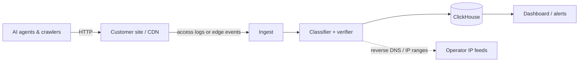

# Architecture — agent-analytics

## 1. Scope
Show site owners which AI agents (training crawlers, AI search indexers, user-triggered assistants)
visit, what they fetch, and where they hit errors.
**MVP:** offline access-log parser + UA classifier + report (text/JSON).
**Product:** real-time collection (edge middleware / JS beacon), verification, dashboards, recommendations.

## 2. System context

## 3. Components
| Module | Responsibility | Status |
|---|---|---|
| `core.parse_line` | Combined/Common Log Format regex parser → `Hit` | MVP |
| `core.classify` | Ordered signature catalogue → (agent, operator, intent); generic automation fallback | MVP |
| `core.analyze` | Streaming aggregation: per-agent hits, paths, statuses, special files, errors | MVP |
| Verifier | Reverse-DNS + published IP ranges → `verified / spoofed / unverified` | Roadmap |
| Edge collector | Cloudflare Worker / Vercel middleware emitting events | Roadmap |
| Recommender | 404 demand mining → "add llms.txt", "mirror /docs as markdown" | Roadmap |

## 4. Data model
`Hit{ip, time, method, path, status, bytes, ua}` → `AgentStats{name, operator, intent, hits, bytes,
paths, statuses, errors, special, first_seen, last_seen}`.
Intent taxonomy is a first-class field (`training | search | user`) because the business answer
differs per intent: block training, welcome search, optimise for user fetches.

## 5. Key flow
Log lines are streamed (constant memory per line, O(agents × paths) state) → parse → classify →
aggregate → report. Unparseable lines are counted, not dropped silently.

## 6. Design decisions
- **Substring signatures, ordered.** UA strings are the only signal available in logs. They're
  ordered so specific signatures (`ChatGPT-User`) match before generic ones (`bot`).
  *Trade-off:* this is spoofable, which is why a verifier stage is mandatory in the product.
- **Separate "unknown automation" bucket** instead of guessing. It keeps precision high and
  shows the size of the unclassified long tail.
- **Query strings stripped** before path aggregation, which avoids cardinality blow-ups.

## 7. Production architecture
- Ingest: HTTPS endpoint + log-drain integrations (Cloudflare Logpush, Fastly, Vercel, S3 pulls).
- Stream: Kafka/Redpanda → classifier workers (stateless) → ClickHouse (`events` table, partitioned by day,
  `ORDER BY (site_id, agent, ts)`); materialised views for daily rollups.
- Signature catalogue served from a versioned config service so it can update without deploys.
- Dashboard: Next.js reading pre-aggregated rollups; alerting via webhooks/Slack.

## 8. Security & privacy
- IPs are personal data under GDPR. Human hits are dropped at ingest, and agent IPs are kept only
  for verification and then truncated.
- Tenant isolation is by `site_id` on every query. Row-level policies live in the API layer.

## 9. Scaling & reliability
Classification costs microseconds per line. The bottleneck is ingest bandwidth, and ClickHouse
handles more than 1M rows/s per node. Targets: event-to-dashboard p95 under 60 s, and 99.9%
ingest availability, buffered at the edge.

## 10. Risks
- UA catalogue maintenance is ongoing work, so community contributions and auto-discovery from
  unknown-automation clusters are needed.
- Agents increasingly use headless Chrome UAs. Behavioural fingerprinting is needed beyond UA strings.
